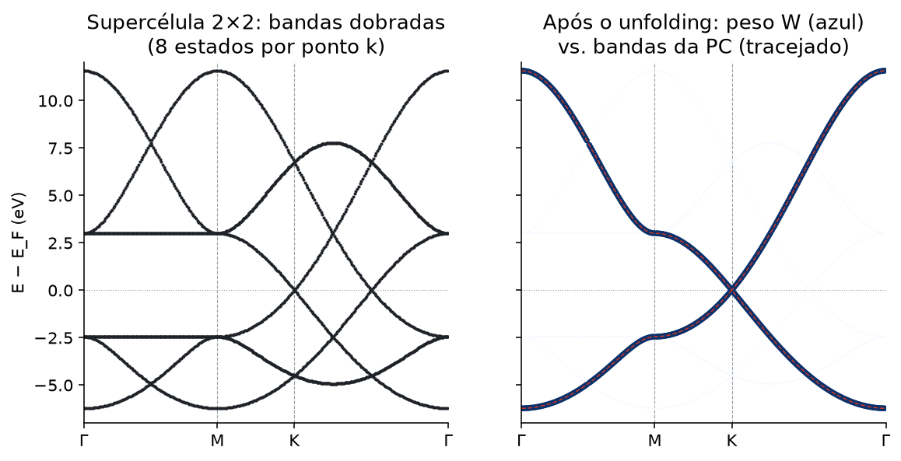
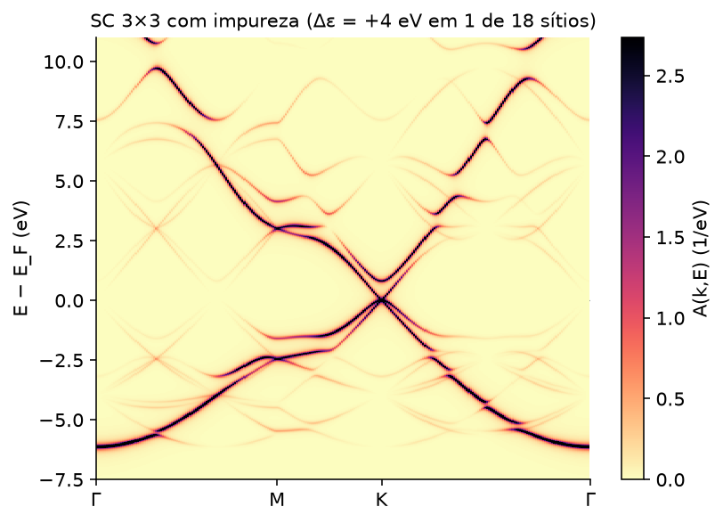
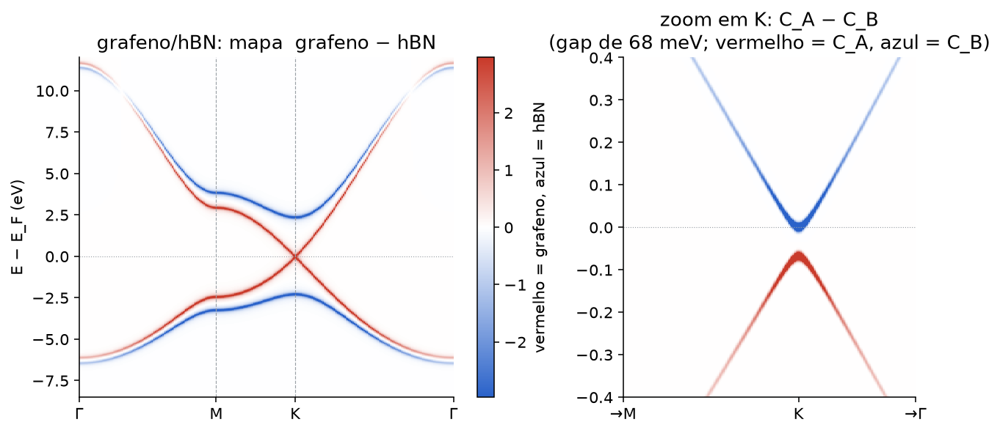

# LowFoldIn

[](https://github.com/nnardoto/LowFoldIn/actions/workflows/ci.yml)
[](LICENSE)
[](https://github.com/nnardoto/LowFoldIn/wiki)


Pós-processamento de estrutura eletrônica em bases localizadas (LCAO), escrito em Fortran 2023.

O LowFoldIn é composto por seis programas de linha de comando e por uma biblioteca de módulos Fortran compartilhada entre eles. Os programas recebem o Hamiltoniano `H(R)` e a matriz de sobreposição `S(R)` no formato `.hsio`, constroem `H(k)` e `S(k)`, resolvem o problema de autovalores generalizado e produzem estruturas de bandas, bandas desdobradas (unfolding) e mapas espectrais projetados em regiões atômicas. Arquivos `.scfout` do OpenMX são convertidos para `.hsio` pelo programa `openmx2hsio`. A configuração de todos os programas é feita por namelists Fortran.

<p align="center">
  
  <br><sub>Supercélula 2×2 de grafeno: as 8 bandas dobradas (esquerda) e as bandas da célula primitiva recuperadas pelo unfolding (direita).</sub>
</p>

<p align="center">
  <a href="#programas">Programas</a> ·
  <a href="#módulos">Módulos</a> ·
  <a href="#instalação">Instalação</a> ·
  <a href="#uso">Uso</a> ·
  <a href="#formulação">Formulação</a> ·
  <a href="#exemplos">Exemplos</a> ·
  <a href="#documentação">Documentação</a>
</p>

## Programas

| Programa | Fonte | Função |
|---|---|---|
| `openmx2hsio` | [`tools/openmx2hsio.f90`](tools/openmx2hsio.f90) | Converte o `.scfout` do OpenMX nas matrizes `H(R)` e `S(R)` (formato `.hsio`); com `--write-structure`, extrai também a estrutura |
| `LowFoldIn` | [`app/main.f90`](app/main.f90) | Estrutura de bandas ao longo de um caminho k |
| `unfold` | [`tools/unfold.f90`](tools/unfold.f90) | Unfolding das bandas da supercélula para a célula primitiva |
| `atomselect` | [`tools/atomselect.f90`](tools/atomselect.f90) | Definição de regiões atômicas nomeadas por índices, camadas, superfícies ou caixas |
| `spectral` | [`tools/spectral.f90`](tools/spectral.f90) | Energias e pesos de projeção por região, num caminho k ou numa grade 2D |
| `specmap` | [`tools/specmap.f90`](tools/specmap.f90) | Mapas espectrais alargados, combinações de regiões (`top-bottom`) e mapas de energia constante |

```text
OpenMX .scfout ──► openmx2hsio ──► H.hsio, S.hsio (+ estrutura)
                                        │
             ┌──────────────────────────┼──────────────────────────────┐
             ▼                          ▼                              ▼
        LowFoldIn                    unfold                  atomselect → spectral → specmap
     (bandas comuns)       (bandas desdobradas, A(k,E))      (mapas por região, contornos de Fermi)
```

## Módulos

Os módulos ficam em [`src/`](src). As rotinas de biblioteca não interrompem a execução: erros são devolvidos ao programa chamador por códigos de status.

| Módulo | Arquivo | Conteúdo |
|---|---|---|
| **Base** | | |
| `types` | [`mod_types.f90`](src/mod_types.f90) | Parâmetros de precisão (`dp`) |
| `terminal_ui` | [`mod_terminal_ui.f90`](src/mod_terminal_ui.f90) | Formatação da saída no terminal |
| `kpath` | [`mod_kpath.f90`](src/mod_kpath.f90) | Caminhos k lineares por partes e grades k 2D, com distância acumulada em 1/Å |
| **Entrada e saída** | | |
| `HS_io` | [`mod_hs_io.f90`](src/mod_hs_io.f90) | Leitura e escrita do formato `.hsio` (v2): container versionado com blocos átomo-átomo esparsos de `H(R)` e `S(R)` |
| `scfout_io` | [`mod_scfout_io.f90`](src/mod_scfout_io.f90) | Leitor do binário `.scfout` do OpenMX 3.9/4.0 |
| `openmx_convert` | [`mod_openmx_convert.f90`](src/mod_openmx_convert.f90) | Montagem de `H(R)` e `S(R)` a partir do `.scfout`, conversão Hartree → eV e deslocamento `H − E_F·S` |
| `structure_io` | [`mod_structure_io.f90`](src/mod_structure_io.f90) | Leitura da estrutura (`&STRUCTURE`, `&SPECIES`, `&ATOMS`), auxiliares de rede e fingerprint da geometria |
| `config` | [`mod_config.f90`](src/mod_config.f90) | Leitura da configuração do programa `LowFoldIn` |
| `bands_io` | [`mod_bands_io.f90`](src/mod_bands_io.f90) | Escrita das bandas em texto, blocos para gnuplot e binário |
| **Cálculo** | | |
| `core` | [`mod_core.f90`](src/mod_core.f90) | Construção de `H(k)` e `S(k)` e diagonalização via LAPACK (`zheev[d]`, `zhegv[d]`) |
| `unfold` | [`mod_unfold.f90`](src/mod_unfold.f90) | Unfolding: ortogonalização de Löwdin, pesos para `M` diagonal (forma fechada) e geral (projetor de grupo), mapeamento de átomos |
| `spectral_projection` | [`mod_spectral_projection.f90`](src/mod_spectral_projection.f90) | Pesos de Mulliken e Löwdin por grupo de orbitais e autoresolvedor hermitiano generalizado |
| `spectral_engine` | [`mod_spectral_engine.f90`](src/mod_spectral_engine.f90) | Laço sobre pontos k do programa `spectral`: leitura das entradas, diagonalização e projeção por região |
| **Regiões e mapas** | | |
| `atomic_regions` | [`mod_atomic_regions.f90`](src/mod_atomic_regions.f90) | Leitura, escrita e validação de `regions.nml`, incluindo o teste de partição |
| `atomic_selection` | [`mod_atomic_selection.f90`](src/mod_atomic_selection.f90) | Seleção de átomos por listas de índices, camadas, fatias ao longo de uma normal e caixas |
| `spectral_data` | [`mod_spectral_data.f90`](src/mod_spectral_data.f90) | Formato intermediário `.spectral.bin` (energias e pesos), que dispensa o Hamiltoniano no pós-processamento |
| `spectral_broadening` | [`mod_spectral_broadening.f90`](src/mod_spectral_broadening.f90) | Alargamento lorentziano ou gaussiano e ocupação de Fermi–Dirac |
| `spectral_map` | [`mod_spectral_map.f90`](src/mod_spectral_map.f90) | Expressões de combinação de regiões (`a+b-c`) e escrita dos mapas |

Dependências dos programas:

| Programa | Módulos utilizados |
|---|---|
| `openmx2hsio` | `scfout_io`, `openmx_convert`, `HS_io` |
| `LowFoldIn` | `config`, `core`, `bands_io` |
| `unfold` | `HS_io`, `unfold` |
| `atomselect` | `structure_io`, `atomic_regions`, `atomic_selection` |
| `spectral` | `spectral_engine`, `spectral_data` |
| `specmap` | `spectral_data`, `spectral_broadening`, `spectral_map` |

Os testes unitários de cada módulo estão em [`test/`](test), e os contratos de interface entre as etapas estão descritos em [`docs/design/contracts.md`](docs/design/contracts.md).

## Características

- Unfolding para matrizes de supercélula `M` diagonais (fórmula fechada, custo O(m)) ou gerais, incluindo supercélulas giradas e cisalhadas como √3×√3 R30° (projetor de grupo, custo O(m²)).
- Mapeamento automático de átomos entre célula primitiva e supercélula a partir das posições.
- Tratamento de bases não ortogonais em todas as etapas, com ortogonalização de Löwdin e pesos de Mulliken ou Löwdin.
- Casos sem spin, colinear e não colinear (espinores).
- Separação entre cálculo e visualização: `spectral` diagonaliza `H(k)` uma única vez; `specmap` gera os mapas a partir do resultado, sem nova diagonalização.
- Paralelismo OpenMP sobre os pontos k, com resultados idênticos bit a bit para qualquer número de threads.
- Verificação da regra de soma do unfolding e da normalização dos pesos em cada execução.
- 12 suítes de testes unitários, além de testes de linha de comando e dos exemplos, executados no CI.

<table>
<tr>
<td width="50%"></td>
<td width="50%"></td>
</tr>
<tr>
<td><sub>Grafeno 3×3 com uma impureza: função espectral desdobrada, com gaps de hibridização e bandas-fantasma.</sub></td>
<td><sub>Grafeno sobre hBN: mapa por camada (vermelho: grafeno; azul: hBN) e gap de 68 meV em K.</sub></td>
</tr>
</table>

<sub>Figuras geradas com modelos tight-binding sintéticos, não com DFT. As entradas correspondentes estão descritas na wiki, em [Modelos Sintéticos](https://github.com/nnardoto/LowFoldIn/wiki/Modelos-Sinteticos).</sub>

## Instalação

### Requisitos

| Dependência | Versão | Observação |
|---|---|---|
| GNU Fortran | ≥ 14 | o código é compilado com `-std=f2023` |
| [fpm](https://fpm.fortran-lang.org/) | ≥ 0.13 | usar o binário oficial das [releases](https://github.com/fortran-lang/fpm/releases); `pip install fpm` instala a 0.12 |
| BLAS e LAPACK | — | OpenBLAS, Accelerate, MKL ou equivalente |
| OpenMP | — | opcional, recomendado |
| gnuplot | — | opcional, para os gráficos dos exemplos |

```bash
# Debian/Ubuntu
sudo apt install gfortran-14 liblapack-dev libblas-dev
# Arch Linux
sudo pacman -S gcc-fortran blas lapack
# macOS (Homebrew; LAPACK fornecido pelo Accelerate)
brew install gcc fpm gnuplot
```

### Compilação e testes

```bash
git clone https://github.com/nnardoto/LowFoldIn.git
cd LowFoldIn
fpm build --profile release
fpm test  --profile release
```

Perfis de compilação definidos em [`fpm.toml`](fpm.toml):

| Perfil | Descrição |
|---|---|
| `release` | `-O3` e OpenMP, sem alvo específico de CPU (recomendado) |
| `native` | como `release`, com `-march=native` |
| `development` | `-O1` com símbolos de depuração |
| `debug` | `-O0`, `-fcheck=all`, armadilhas de ponto flutuante e inicialização com NaN |
| `debug-sanitize` | como `debug`, com AddressSanitizer e UBSan |

### Verificação da instalação

```bash
bash examples/surface_spectral/run_example.sh
```

O script gera um slab sintético com estados de superfície, executa o fluxo completo de análise por região e produz os mapas em PNG e PDF.

## Uso

### Unfolding

```fortran
&UNFOLD
    ProjectName = "sc"
    HDataFile   = "sc_H.hsio"
    SDataFile   = "sc_S.hsio"
    OutputDir   = "resultados"
    M(1,:) = 2, 0, 0            ! linhas de M: A_i = Σ_j M_ij a_j
    M(2,:) = 0, 2, 0
    M(3,:) = 0, 0, 1
    PCStructureFile = "pc.nml"  ! mapeamento automático de átomos
    SCStructureFile = "sc.structure.nml"
    WriteSpectralFunction = .true.
    Broadening = 0.05
    Emin = -5.0, Emax = 5.0, nE = 1000
/
&PCPATH
4
0.000000  0.000000  0.0   100   ! Γ
0.500000  0.000000  0.0    58   ! M
0.666667  0.333333  0.0   115   ! K
0.000000  0.000000  0.0     1   ! Γ
/
```

```bash
mkdir -p resultados
OMP_NUM_THREADS=8 fpm run unfold --profile release -- unfold.nml
```

Ao final da execução, o programa informa o desvio da regra de soma (Σ W igual ao número de orbitais da célula primitiva), que deve estar na precisão de máquina.

### Análise por região

As regiões são definidas a partir da geometria. Os comandos abaixo supõem os binários no `PATH`; alternativamente, use `fpm run atomselect --profile release -- <argumentos>`.

```bash
atomselect surface  slab.nml --regions regions.nml --normal 0 0 1 --top 1 --bottom 1
atomselect select   slab.nml --regions regions.nml --name interior --atoms "2-7"
atomselect validate slab.nml regions.nml    # verifica se as regiões formam uma partição
```

O `spectral` diagonaliza `H(k)` e grava energias e pesos num arquivo binário:

```fortran
&SPECTRAL
    h_file           = 'slab_H.hsio'
    s_file           = 'slab_S.hsio'
    structure_file   = 'slab.nml'
    regions_file     = 'regions.nml'
    method           = 'mulliken'
    energy_reference = 'fermi'      ! openmx2hsio desloca E_F para 0 por padrão
    output_prefix    = 'slab'
/
&KPATH
    nvertex = 3
    vertex(:,1) = 0.5, 0.0, 0.0
    vertex(:,2) = 0.0, 0.0, 0.0
    vertex(:,3) = 0.5, 0.5, 0.0
    label   = 'X', 'G', 'M'
    npoints = 60, 85
/
```

O `specmap` gera os mapas a partir desse arquivo:

```fortran
&SPECMAP
    spectral_file = 'slab.spectral.bin'
    kernel        = 'lorentzian'
    width_ev      = 0.05
    emin = -3.5, emax = 3.5, ne = 701
    maps          = 'total', 'top', 'bottom', 'top-bottom'
    output_prefix = 'slab'
/
```

Alterações no alargamento, na janela de energia ou nas combinações de regiões exigem apenas uma nova execução do `specmap`. Com `&KGRID` no lugar de `&KPATH`, o mesmo fluxo produz mapas de energia constante e contornos de Fermi.

## Formulação

**Unfolding.** Cada autoestado $|KN\rangle$ da supercélula é escrito na base ortogonal de Löwdin, $C'_{KN} = S(K)^{1/2}\,C_{KN}$, e projetado nos autoestados $F_{k,n}$ do operador de translação da célula primitiva. O peso espectral no ponto $k$ da célula primitiva é

$$
W^{k}_{KN} = \sum_{n=1}^{p} \big| F_{k,n}^{\dagger}\, C'_{KN} \big|^{2},
$$

em que a soma percorre os $p$ orbitais distintos da célula primitiva. A função espectral desdobrada é $A(k,E) = \sum_N W^{k}_{KN}\,\delta(E-\varepsilon_{KN})$, com a delta substituída por uma lorentziana ou gaussiana. A regra de soma $\sum_N W^{k}_{KN} = p$ é verificada em cada execução.

**Análise por região.** Para uma região $P$, o peso $w_n^P(k)$ é a fração do estado $n$ localizada nos átomos de $P$ (Mulliken ou Löwdin), com soma unitária sobre uma partição. O mapa projetado é

$$
A_P(k,E) = \sum_n w_n^P(k)\, K\big(E-\varepsilon_n(k)\big),
$$

em que $K$ é o núcleo de alargamento.

O mapeamento de pontos k para `M` não diagonal e demais detalhes estão em [Metodologia do unfolding](https://github.com/nnardoto/LowFoldIn/wiki/Metodologia-do-Unfolding) e [Metodologia da análise espectral](https://github.com/nnardoto/LowFoldIn/wiki/Metodologia-da-Analise-Espectral).

> [!IMPORTANT]
> Os mapas espectrais são pesos de projeção alargados, não simulações de ARPES: não incluem elementos de matriz de fotoemissão, estados finais nem efeitos de muitos corpos.

## Exemplos

| Diretório | Conteúdo |
|---|---|
| [`surface_spectral`](examples/surface_spectral) | Fluxo `atomselect → spectral → specmap` num slab sintético com estados de superfície |
| [`UnfoldChain1D`](examples/UnfoldChain1D) | Unfolding de uma cadeia 1D |
| [`UnfoldChain1D_Auto`](examples/UnfoldChain1D_Auto) | Cadeia 1D com mapeamento automático de átomos |
| [`UnfoldChain1DShearedM`](examples/UnfoldChain1DShearedM) | Matriz `M` não diagonal (supercélula cisalhada) |
| [`UnfoldDiatomic`](examples/UnfoldDiatomic) | Célula primitiva com dois átomos |
| [`UnfoldSpinorNonCollinear`](examples/UnfoldSpinorNonCollinear) | Spin não colinear (espinores) |
| [`UnfoldGaNPaperH`](examples/UnfoldGaNPaperH) | Validação contra o cálculo DFT de GaN do artigo de referência |

## Documentação

A documentação completa, em português, está na [wiki do projeto](https://github.com/nnardoto/LowFoldIn/wiki):

| Introdução | Metodologia | Referência |
|---|---|---|
| [Instalação](https://github.com/nnardoto/LowFoldIn/wiki/Instalacao-e-Compilacao) | [Fundamentos teóricos](https://github.com/nnardoto/LowFoldIn/wiki/Fundamentos-Teoricos) | [Formatos de arquivo](https://github.com/nnardoto/LowFoldIn/wiki/Formatos-de-Arquivo) |
| [Guia rápido](https://github.com/nnardoto/LowFoldIn/wiki/Guia-Rapido) | [Unfolding](https://github.com/nnardoto/LowFoldIn/wiki/Metodologia-do-Unfolding) | [Solução de problemas](https://github.com/nnardoto/LowFoldIn/wiki/Solucao-de-Problemas) |
| [Modelos sintéticos](https://github.com/nnardoto/LowFoldIn/wiki/Modelos-Sinteticos) | [Análise espectral](https://github.com/nnardoto/LowFoldIn/wiki/Metodologia-da-Analise-Espectral) | [Desempenho e paralelismo](https://github.com/nnardoto/LowFoldIn/wiki/Desempenho-e-Paralelismo) |

A referência das ferramentas de superfície, em inglês, está em [`docs/`](docs): [`atomselect`](docs/atomselect.md), [`spectral`](docs/spectral.md), [`specmap`](docs/specmap.md) e [`performance`](docs/performance.md).

## Referência

O unfolding implementa o formalismo para orbitais centrados em átomos de:

> J. Quan, N. Rybin, M. Scheffler e C. Carbogno,
> *Efficient band structure unfolding with atom-centered orbitals: General theory and application*,
> Phys. Rev. B **113**, 085112 (2026). DOI: [10.1103/7xym-7388](https://doi.org/10.1103/7xym-7388)

Trabalhos que utilizem o unfolding devem citar essa referência. Uma citação própria do LowFoldIn, com DOI, será disponibilizada com a primeira release arquivada.

## Estado do projeto

Software de pesquisa em desenvolvimento. As ferramentas foram validadas em modelos sintéticos, em casos de teste reduzidos e no exemplo DFT do artigo de referência. Recomenda-se verificar a regra de soma e as normalizações antes de publicar resultados. As limitações atuais, como o suporte restrito ao OpenMX 3.9/4.0 e a coordenadas cartesianas em Å, estão listadas na [wiki](https://github.com/nnardoto/LowFoldIn/wiki/Limitacoes).

## Contribuição

Issues e pull requests são bem-vindos, incluindo dúvidas de uso e relatos de comportamento inesperado. Conversores para outros códigos de base local (SIESTA, FHI-aims, CP2K) são de particular interesse: basta produzir `H(R)` e `S(R)` no formato `.hsio` para que as demais ferramentas funcionem sem alterações.

Relatos de mudanças numéricas devem informar:

- compilador e versão, implementação de BLAS/LAPACK e número de threads;
- uma entrada mínima que reproduza o resultado;
- os desvios da regra de soma esperados e obtidos.

Pull requests devem passar em `fpm test --profile debug`.

## Licença

Distribuído sob a GNU General Public License, versão 3 ou posterior (`GPL-3.0-or-later`). Veja [`LICENSE`](LICENSE).

Autor: Nathanael Nardoto Batista
